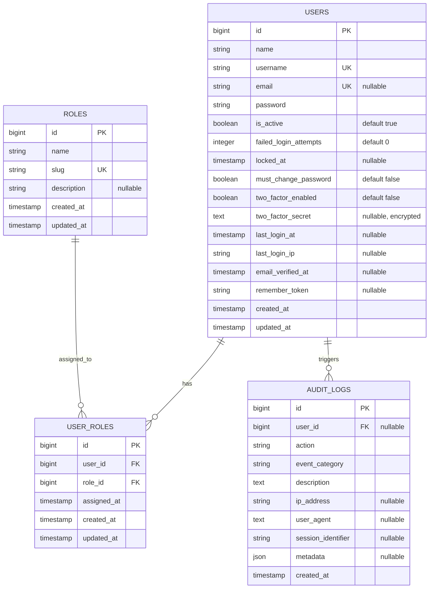
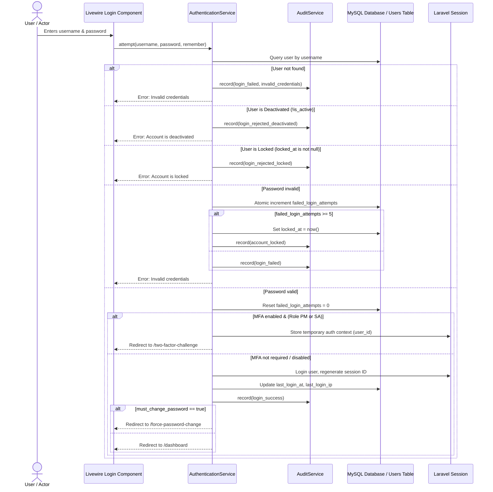

# ARCHITECTURAL DESIGN DOCUMENT & IMPLEMENTATION PLAN
## Pharmacy Management System (PMS) – UC-33: Log in and Log out

### 1. Architectural Overview
The Pharmacy Management System adopts a **Modular Monolith** architecture with strict separation of concerns, built upon Laravel 12 and Livewire 3:
- **Presentation Layer**: Livewire 3 Components (`Login`, `TwoFactorChallenge`, `ForcePasswordChange`) using Tailwind CSS.
- **Application & Service Layer**: `AuthenticationService`, `AuthorizationService`, `AuditService` orchestrating business workflows.
- **Domain & Data Layer**: Eloquent Models (`User`, `Role`, `AuditLog`) with database transactions, atomic operations, and strict constraints.
- **Middleware & Security Layer**: Dedicated HTTP Middleware (`EnsureAccountIsActive`, `EnsurePasswordIsChanged`, `EnsureRoleAccess`) and session lifecycle guards.

### 2. Entity Relationship Diagram (ERD)

### 3. System Roles & Access Matrix
The system enforces 4 principal roles (slugs):
- `pharmacy_staff` (PS): Frontline operations (dispensing, sales).
- `pharmacy_manager` (PM): Pharmacy operations supervision, staff monitoring. MFA configurable.
- `owner` (OW): Business owner, executive authority.
- `system_administrator` (SA): Technical administration, security management. MFA configurable. Strictly denied access to patient, prescription, sales, or financial data.

### 4. Authentication Workflow

### 5. Implementation Phases
1. **Database Schema & Migrations**: Update `users` table, create `roles`, `user_roles`, and `audit_logs` tables.
2. **Domain Models & Enums**: `UserRole` Enum, `User`, `Role`, `AuditLog` models with immutable safeguards.
3. **Application Services**: `AuthenticationService`, `AuthorizationService`, `AuditService`.
4. **Middleware & Gates**: `EnsureAccountIsActive`, `EnsurePasswordIsChanged`, `EnsureRoleAccess`, and Gates.
5. **Livewire 3 UI Components**:
   - `App\Livewire\Auth\Login`
   - `App\Livewire\Auth\TwoFactorChallenge`
   - `App\Livewire\Auth\ForcePasswordChange`
   - Authenticated Layout & Role-aware navigation
   - Access Denied view
6. **Automated Feature & Security Test Suite**: Testing all 18 specified scenarios + security controls.
